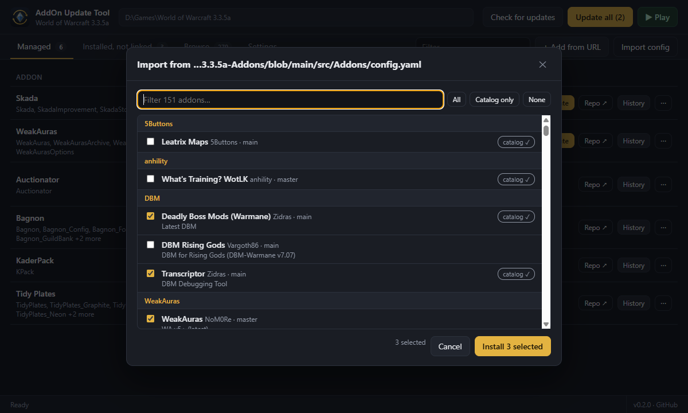
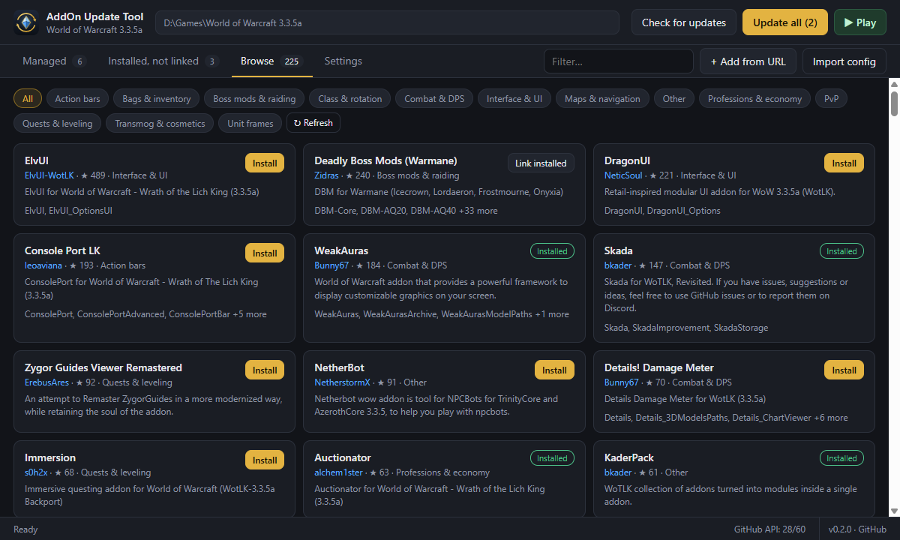
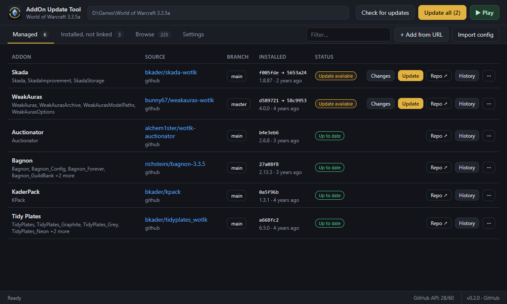

<h1 align="center">Changelog</h1>

All notable changes to AddOn Update Tool 3.3.5a. 
Downloads are on the <a href="https://github.com/Tntdruid/AddOn-Update-Tool-335a/releases">Releases</a> page.

---

## [Unreleased]

---

## [0.4.0] — 2026-11-28

> **Modules and libraries.** Install the client addon that sits inside a server module straight from its folder link, and fix a missing Ace3 with one click. The catalog grows to 287 addons.

### ✨ New
- **Links to a folder inside a repo.** Paste a link such as `…/tree/main/addon/PocketVendor`, and only that folder is installed and updated. This suits AzerothCore modules that ship a client addon next to the server code.
- **Ace3 in the catalog.** It comes from [Tntdruid/Ace3](https://github.com/Tntdruid/Ace3), the official Release-r960 (the last Ace3 release for WotLK), so a missing Ace3 dependency installs with one click.
- New in the catalog: MobLootTracker, MyAutoVendor, PocketVendor and PocketStorage. **The catalog grows from 279 to 287 addons.**

### 🐛 Fixed
- A folder link was read as a branch name, which caused a misleading "branch does not exist" warning.
- The missing-dependency warning after an install named another addon that also lacked the dependency, instead of the one just installed.

### 🧰 For contributors
- The build tools no longer pull in a vulnerable `minimatch` (CVE-2026-118764). An npm override lifts only the affected versions to 11.0.1 or newer. It only touched the tooling that builds the exe; the app itself was never affected.

---

## [0.3.0] — 2026-11-21

> **Bring your list.** Import shared addon lists, such as the one from [WoW-3.3.5a-Addons](https://github.com/NoM0Re/WoW-3.3.5a-Addons), and pick what to install from a checklist. The catalog grows to 279 verified addons.

### ✨ New
- **Import checklist.** *Import config* now reads a file **or a link**, including shared lists where every entry is commented out with `#`. You get a checklist grouped by the list's own sections, with notes, "Installed" and "catalog ✓" badges, a filter, and *All / Catalog only / None* buttons. Progress shows while the addons install.
- **Smarter branches.** If a config names a branch that no longer exists (e.g. `main` when the repo uses `master`), the best existing branch is used and you get a warning, instead of the install failing.

### ⚡ Improved
- **Catalog: 225 → 279 addons.** It now also includes the curated WoW-3.3.5a-Addons list; each addon is still checked for `Interface: 30300`.
- The app uses whichever catalog copy is newer, the bundled one or the online one.
- Searching in the import list also matches repository names.

### 🐛 Fixed
- **You couldn't type in the *Add from URL* dialog**, and checkboxes inside dialogs couldn't be ticked. A keyboard and click handler cancelled the events. A new test guards against this.
- Commit hashes ("old → new") in the *Installed* column no longer wrap onto two lines.

### 🧰 For contributors
- `tools/build-catalog.js` accepts `seedConfigs` (links to AddOns-Update-Tool configs) as trusted sources.

---

## [0.2.0] — 2026-11-21

> **Find, inspect and fix.** Browse a catalog of 225 verified 3.3.5a addons, see what an update changes before you install it, and fix missing dependencies with one click.

### ✨ New
- **Browse tab.** A catalog of **225 verified 3.3.5a addons**, including ElvUI, DBM, WeakAuras, Skada, Details, Auctionator and Bagnon. It has categories and search and is sorted by popularity. Click *Install* to add one, or *Link installed* for addons you already have.
- **See what's new.** The *Changes* button lists the commits between your version and the latest, with author, date and link, before you update.
- **Missing dependencies.** If an addon needs something you don't have (e.g. `DBM-Core`), you get a warning and an *Install* button that fetches it from the catalog. This also happens right after an install.
- **Repo links.** Each addon has a *Repo ↗* button, the status bar shows the version and links to GitHub, and *Settings → About* links to releases and issues.

### ⚡ Improved
- The catalog is fetched from this repository, so it grows without a new app release. Offline, the bundled copy is used.
- *Find repo…* suggests the catalog match first.

### 🐛 Fixed
- The version shown in the app was Electron's version in some cases.

### 🧰 For contributors
- `tools/build-catalog.js` builds the catalog from GitHub and keeps only addons whose `.toc` says `Interface: 30300`. `tools/catalog-config.json` holds overrides.

---

## [0.1.0] — 2026-11-21

> **First release.** A modern, GUI-based take on [AddOns-Update-Tool](https://github.com/alchem1ster/AddOns-Update-Tool): pick your Wow.exe, paste a URL, and stay up to date.

### ✨ New
- **Desktop app** for updating addons from **GitHub, GitLab and Codeberg/Gitea**.
- **Smart branch picking.** A `wotlk` or `3.3.5` branch is chosen automatically when one exists. Wrath *Classic* branches are skipped.
- **Cheap update checks.** Responses are cached with ETags, so checks barely touch GitHub's 60-requests-per-hour limit.
- **Compatibility warnings** for addons built for newer clients than 3.3.5a.
- **Smart folder detection.** Fixes `Repo-master` folder names, finds nested addons, keeps embedded libs, and handles multi-module repos such as DBM.
- **Safe installs with one-click rollback.** Files are staged first, and the last 5 versions of each addon are kept.
- **Installed, not linked.** Finds a repository for addons you already have.
- **Import** of `config.yaml` / `config.json` from the original tool.
- **Optional access tokens**, encrypted with Windows DPAPI, and a **▶ Play** button.

### 🧰 For contributors
- GitHub Actions run the tests on every push and build a portable `.exe` release for every `v*` tag.

[Unreleased]: https://github.com/Tntdruid/AddOn-Update-Tool-335a/compare/v0.4.0...HEAD
[0.4.0]: https://github.com/Tntdruid/AddOn-Update-Tool-335a/compare/v0.3.0...v0.4.0
[0.3.0]: https://github.com/Tntdruid/AddOn-Update-Tool-335a/compare/v0.2.0...v0.3.0
[0.2.0]: https://github.com/Tntdruid/AddOn-Update-Tool-335a/compare/v0.1.0...v0.2.0
[0.1.0]: https://github.com/Tntdruid/AddOn-Update-Tool-335a/releases/tag/v0.1.0
