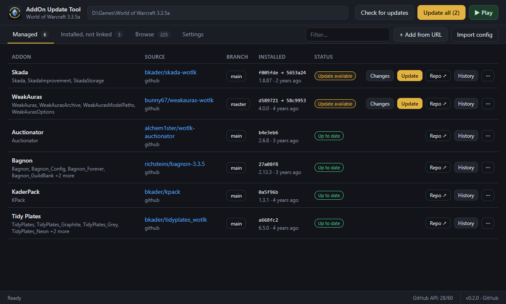
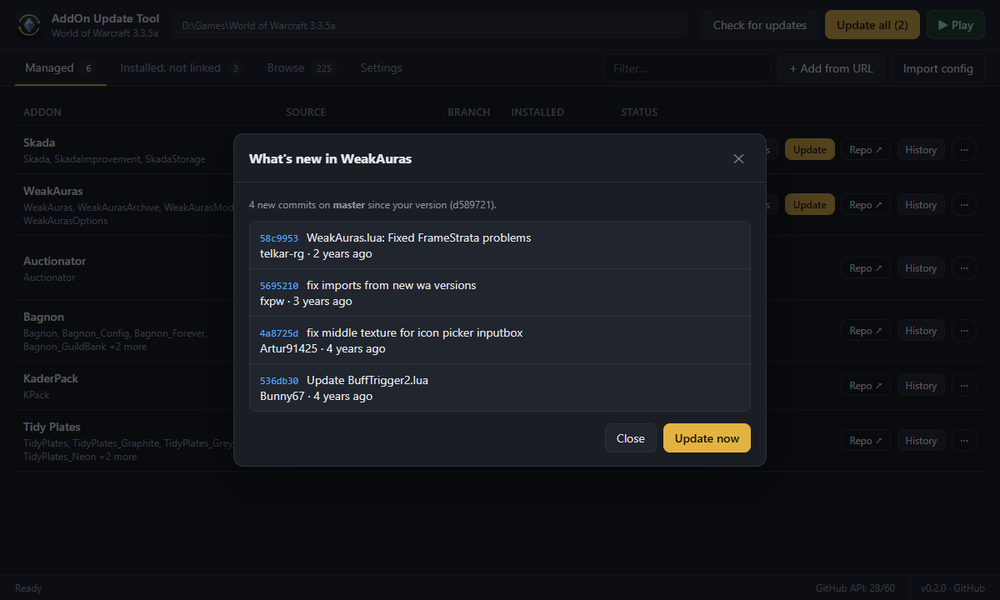
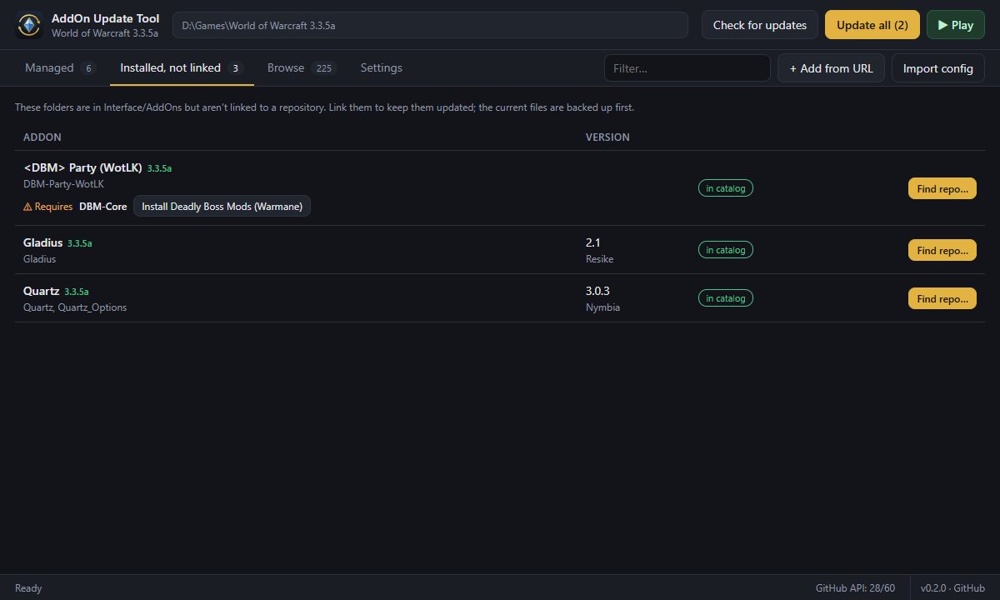

<p align="center"></p>

# AddOn Update Tool 3.3.5a

A desktop app that keeps World of Warcraft **3.3.5a (WotLK)** addons up to date from GitHub, GitLab and Gitea/Codeberg. It is a modern take on [alchem1ster/AddOns-Update-Tool](https://github.com/alchem1ster/AddOns-Update-Tool).

<p align="center"></p>

<table>
<tr>
<td width="50%"><br /><b>Browse</b>: 200+ verified 3.3.5a addons, one-click install</td>
<td width="50%"><br /><b>Changes</b>: see what's new before you update</td>
</tr>
<tr>
<td width="50%"><br /><b>Installed, not linked</b>: link addons you already have, and fix missing dependencies</td>
<td width="50%"></td>
</tr>
</table>

## What it does better

| | Original | This tool |
|---|---|---|
| Interface | Console | Desktop GUI (Electron) |
| Setup | Hand-written `config.yaml` | Paste a URL, or link addons you already have installed. Old configs can be imported |
| Download | Full `git clone` | Downloads only the archive for the newest commit |
| Update check | Clones each time | One cached API call per addon (ETag). A 304 response does not count against GitHub's rate limit |
| Branch | You choose it | Picks a `wotlk`/`3.3.5` branch automatically when one exists. Wrath *Classic* branches are skipped |
| Compatibility | — | Reads `## Interface` and warns about addons built for newer clients |
| Folder names | — | Fixes `Repo-master` folders, finds addons nested deep in the repo, and keeps embedded libs inside their addon |
| Collection repos | — | Linking one folder to a repo with many addons installs only that folder |
| Safety | Backup | Writes to staging first, then swaps folders in. If an install fails, the previous version is restored |
| Rollback | Manual | Keeps the last 5 versions per addon. Restore with one click, and a restore can itself be undone |
| Finding addons | Know the URL | **Browse** tab: a catalog of 200+ verified 3.3.5a addons (every entry has an `Interface: 30300` .toc), with categories and one-click install |
| Before updating | — | **Changes** shows the commits between your version and the new one |
| Dependencies | — | Warns when a required dependency (`## Dependencies`) is missing and installs it from the catalog with one click |
| Unknown addons | — | Lists installed addons that aren't linked to a repo and suggests repos from the `.toc` file and a GitHub search |
| Tokens | — | Optional tokens per host, encrypted with Windows DPAPI |

## Download

Get `AddonUpdateTool-x.y.z-portable.exe` from [Releases](https://github.com/Tntdruid/AddOn-Update-Tool-335a/releases/latest). No installation is needed. Releases are built automatically by GitHub Actions when a `v*` tag is pushed.

## Usage

1. Start the app and select `Wow.exe`. If the exe sits in the WoW folder, it finds the folder on its own.
2. **+ Add from URL**: paste e.g. `https://github.com/Zidras/DBM-Warmane`.
3. **Installed, not linked**: use **Find repo…** to link addons you already have.
4. **Check for updates**, then **Update all**, then **▶ Play**.

The tool stores its state in `AddonUpdateTool.json` next to `Wow.exe` and its backups in `Interface/AddOns.backups`. SavedVariables (`WTF/`) are never touched.

## Development

```powershell
npm install
npm start        # run the app
npm test         # node:test suite
npm run dist     # portable .exe in dist/
```

Structure:

- `src/core/`: platform-independent logic (TOC parser, providers, archive analysis, installer, updater), fully covered by tests
- `src/main/`: Electron main process and IPC (sandboxed renderer, contextIsolation)
- `src/renderer/`: UI in plain HTML/CSS/JS, with no framework
- `src/catalog/addons.json`: the addon catalog. The app fetches the latest copy from this repo, so catalog updates need no new release

### Updating the catalog

```powershell
$env:GITHUB_TOKEN = gh auth token; node tools/build-catalog.js
```

The script searches GitHub for 3.3.5a addons and keeps only repos whose main addon has `## Interface: 30300`. It uses the same folder detection as the app. To force-include or exclude repos, or to override names and categories, edit `tools/catalog-config.json`.
